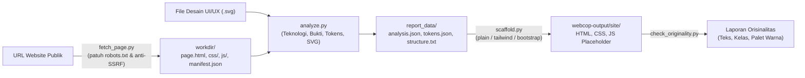

<div style="text-align: center;">

<br />

<a href="https://mfnhstudio.gt.tc"></a>
<a href="https://linkedin.com/in/nasrulhaq"></a>
<a href="https://instagram.com/nasrul.elhaq_"></a>
<a href="mailto:mohfathinasrulhaq@gmail.com"></a>
<a href="https://sociabuzz.com/noxora_studio/tribe"></a>

</div>

<br />


# WebCop

Skill AI Agent dan CLI berbasis Python (**zero-dependency**, hanya stdlib Python 3.8+) untuk mempelajari struktur, teknologi, sistem layout, dan *design tokens* dari **halaman web publik** maupun **file desain UI/UX (`.svg`)**, lalu membuat kerangka proyek baru yang orisinal dengan konten placeholder.

---

## Ilustrasi Alur Kerja



---

## Pembaruan Terbaru

- **Mode Desain UI/UX (`.svg`)**: `analyze.py` kini bisa membaca file `.svg` (hasil ekspor Figma/Illustrator) tanpa `page.html`, mengekstrak warna, font, `border-radius`, `viewBox`, dan nama layer (`<g id="...">`).
- **Pemeriksa Orisinalitas (`scripts/check_originality.py`)**: Membandingkan proyek hasil `scaffold.py` dengan situs sumber (kemiripan teks 3-gram, nama kelas CSS, dan jarak palet warna RGB).
- **Perbaikan `robots.txt` & Anti-SSRF (`scripts/fetch_page.py`)**: Membedakan status `parsed`, `missing` (404), dan `unreadable` (timeout/5xx) agar error jaringan tidak dianggap blokir palsu, serta memblokir `localhost` dan IP privat.
- **Deteksi Berbasis Bukti & Peringatan (`scripts/analyze.py`)**: Menambahkan `schema_version`, `technology_evidence` (`{temuan, bukti, keyakinan}`), `warnings`/`missing` untuk data kosong atau SPA, dukungan folder `Ctrl+S` (`*_files/`), serta deteksi SSR & CMS.

---

## Persyaratan

- **Python 3.8+** (tanpa library eksternal / `pip install` tambahan).

---

## Cara Instalasi ke AI Agent

Salin folder `WebCop/` ke direktori skill agent yang kamu gunakan:

- **Antigravity**: taruh di `.agent/skills/webcop/` pada workspace atau direktori global skills Antigravity.
- **Claude**: unggah paket skill atau taruh di `~/.claude/skills/webcop/`.
- **Codex**: taruh di folder skills Codex, atau salin `AGENTS.md` ke root proyek.

Semua platform membaca file `SKILL.md` (dan `AGENTS.md` untuk Codex) yang sama.

---

## Cara Penggunaan (CLI)

### 1. Mode Website (URL Publik)
```bash
python scripts/fetch_page.py "https://example.com" --out workdir
python scripts/analyze.py workdir --out report_data --format all
python scripts/scaffold.py report_data --url "https://example.com" --root webcop-output --template plain
python scripts/check_originality.py workdir webcop-output/example-com/site
```

### 2. Mode Desain UI/UX (`.svg`)
```bash
python scripts/analyze.py path/ke/design.svg --out report_data
python scripts/scaffold.py report_data --root webcop-output --template tailwind
```
*(Pilihan `--template`: `plain`, `tailwind`, atau `bootstrap`)*

---

## Menjalankan Unit Test

```bash
python -m unittest discover -s tests -v
```

---

## Aturan Wajib & Etika

- Selalu patuhi `robots.txt` situs target.
- Hanya gunakan pada halaman publik (jangan mengakses halaman di balik login, paywall, atau anti-bot).
- Jangan menyalin konten, gambar, logo, atau merek dagang secara langsung—gunakan hasil analisis untuk membangun karya yang orisinal dengan placeholder.
